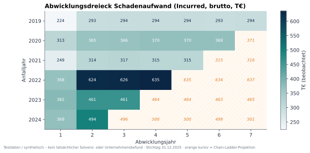
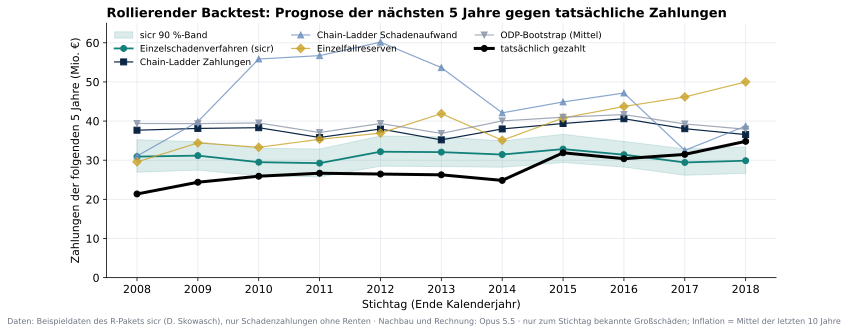

# Aktuar1 – KI-gestützte Aktuararbeit in der Schadenversicherung

Dieses Projekt zeigt an zwei Fallstudien, wie weit ein KI-Modell (Claude Opus 5.5) aktuarielle Arbeit in der Nicht-Lebensversicherung selbstständig verrichten kann: von der Datenprüfung über Reservierung, Tarifierung und Risikokapital bis zum Methodenvergleich mit Backtest. Alle Rechnungen sind als Python-Skripte enthalten und lassen sich reproduzieren.

> **Hinweis:** Teil 1 beruht auf vollständig synthetischen Testdaten, Teil 2 auf den anonymisierten Beispieldaten des R-Pakets `sicr`. Die Ergebnisse sind **kein Unternehmens-, Solvenz- oder Tarifbefund** und ersetzen keine aktuarielle Prüfung oder Freigabe.

| Teil | Fragestellung | Datengrundlage | Kernergebnis |
|---|---|---|---|
| [1 · Risikobewertung Nicht-Leben](#teil-1--risikobewertung-nicht-leben) | Kann die KI eine vollständige Risikobewertung für einen Kfz- und Sachbestand erstellen? | synthetisches Testset [56eli/aktuartestrepo](https://github.com/56eli/aktuartestrepo) | 36 Auswertungen in 30 Diagrammarten; vier fachliche Fehler im Testset aufgedeckt |
| [2 · Einzelschadenreservierung im Praxistest](#teil-2--stochastische-einzelschadenreservierung-im-praxistest) | Bewertet die stochastische Einzelschadenreservierung Großschäden besser als die Marktverfahren? | Beispieldaten des R-Pakets [dskowasch/sicr](https://github.com/dskowasch/sicr) | mittlerer Prognosefehler 18 % statt 39 % (Chain-Ladder); Bandbreiten jedoch zu schmal |

---

## Teil 1 · Risikobewertung Nicht-Leben

**Auftrag:** Ein synthetischer Bestand (2.000 Policen × 6 Jahre, Kfz und Sach, 738 Schäden, XL-Rückversicherung, Zinskurve, Kumulereignisse) wird geprüft und aktuariell ausgewertet.

**Verfahren:** Poisson-GLM mit Out-of-time-Test, Bühlmann-Straub-Credibility, Chain-Ladder (Zahlungen und Schadenaufwand), Bornhuetter-Ferguson, Mack-Standardfehler, Monte-Carlo-Gesamtschaden mit Excess-of-Loss, Stresstests aus dem Szenariokatalog, Prämien- und Reserverisiko nach Standardformel-Logik.

**Ergebnisse (Stichtag 31.12.2025, brutto):**

| Kennzahl | Wert |
|---|---|
| Endschaden Chain-Ladder Schadenaufwand / Referenzwert | 2.584 T€ / 2.572 T€ (+0,5 %) |
| Endschaden Chain-Ladder Zahlungen | 3.216 T€ (+25 %, Ursache: Datenfehler, siehe unten) |
| Schadenreserve, Variationskoeffizient | 248 T€, 3 % |
| Jahresschaden netto, VaR 99,5 % | 984 T€ bei 628 T€ Prämie |
| Erwartetes Ergebnis vor Kosten im kombinierten Stress | −18 T€ |
| SCR Prämien- und Reserverisiko (illustrativ) | 154 T€ |

**Befunde zum Testset**, die das mitgelieferte Audit nicht enthält:

1. **Verzerrte letzte Diagonale:** Der Generator schließt offene Schäden am letzten Bewertungspunkt; jede Zahlungsdiagonale 2025 springt nach oben.
2. **Lücke im Abwicklungsraster:** Der 48-Monats-Bewertungspunkt fehlt.
3. **Kein echtes IBNR:** Alle Schäden sind vor dem Stichtag gemeldet.
4. **Zu gutartige Einzelreserven:** Der Schadenaufwand ist nach einem Jahr zu ~99 % ausentwickelt.

<p align="center"></p>

Alle 36 Grafiken liegen in [`teil1_risikobewertung/grafiken`](teil1_risikobewertung/grafiken), die Kennzahlen in [`ergebnisse/results.json`](teil1_risikobewertung/ergebnisse/results.json).

---

## Teil 2 · Stochastische Einzelschadenreservierung im Praxistest

**Leitfrage:** Bewertet die stochastische Einzelschadenreservierung (`sicr`, D. Skowasch, aufbauend auf Murphy/McLennan 2006) bekannte Großschäden besser als die marktüblichen Verfahren?

**Die Methode in Kürze:** Jeder bekannte Großschaden befindet sich in einem Zustand aus *Jahr seit Großwerden* und *Reserveklasse*. Für jedes Folgejahr wird aus den historischen Beobachtungen im gleichen Zustand zufällig eine Zahlung samt neuer Reserveklasse gezogen. Tausendfache Wiederholung liefert eine Verteilung der künftigen Zahlungen, brutto und netto auf Schadenebene.

**Testaufbau:**

- Python-Nachbau des Verfahrenskerns nach dem Quellcode von `sicr` 1.1.1, Parameter wie im Paketbeispiel (Schwelle 400.000 €, fünf Reserveklassen, Pools aus 10 Kalenderjahren, Nachlauf Jahr 17–50).
- Rollierender Backtest über elf Stichtage (2008–2018): Prognose der Zahlungen der folgenden fünf Jahre, Vergleich mit den tatsächlich gezahlten Beträgen.
- Alle Verfahren bewerten dieselben 590–842 zum Stichtag bekannten Großschäden.

**Ergebnisse:**

| Verfahren | mittlerer absoluter Fehler | bestes Verfahren an … Stichtagen |
|---|---:|---:|
| **Stochastische Einzelschadenreservierung (sicr)** | **18 %** | **8 von 11** |
| Chain-Ladder Zahlungen | 39 % | 1 |
| Einzelfallreserven | 40 % | 1 |
| ODP-Bootstrap (Mittelwert) | 44 % | 0 |
| Chain-Ladder Schadenaufwand | 68 % | 1 |

- **Bandbreiten zu schmal:** Nur 4 von 11 Ist-Werten liegen im 90 %-Intervall (Bootstrap: 1 von 11), weil die Pools als feststehend behandelt werden.
- **Vorsichtige Einzelfallreserven:** Zum Stichtag 2023 liegen sie 83 % über dem Best Estimate (171,9 vs. 93,8 Mio. €).
- **Rückversicherung:** Den Anstieg der XL-Zahlungen ab 2015 verfehlen sicr und die Brutto-Netto-Quote gleichermaßen.
- **Sensitivität:** Poolfenster und Schwelle verschieben den Best Estimate um bis zu 10 %, die Klassengrenzen kaum.

<p align="center"></p>

**Antwort auf die Leitfrage:** Ja für den Erwartungswert, für die Bandbreite noch nicht.

**Einschränkungen:** Nachbau nicht gegen das R-Original gegengerechnet; ohne Renten, Spätgroßschäden, Sonderschäden und Indexklausel; ein einzelner Datensatz; Chain-Ladder auf Großschadenkohorten statt auf dem üblichen Anfalljahresdreieck; Fünf-Jahres-Fenster statt Endschaden.

---

## Reproduzieren

Voraussetzung: Python 3.10 oder neuer.

```bash
pip install -r requirements.txt

# Teil 1: Testset holen und Analyse rechnen (≈ 10 Sekunden)
git clone --depth 1 https://github.com/56eli/aktuartestrepo.git teil1_risikobewertung/daten/aktuartestrepo
python teil1_risikobewertung/skripte/analyse_risikobewertung.py

# Teil 2: Beispieldaten des R-Pakets sicr holen, Backtest und Grafiken rechnen (≈ 20 Sekunden)
git clone --depth 1 https://github.com/dskowasch/sicr.git teil2_einzelschadenreservierung/daten/sicr
python teil2_einzelschadenreservierung/skripte/sicr_nachbau_backtest.py
python teil2_einzelschadenreservierung/skripte/grafiken_erzeugen.py
```

Alle Zufallszahlen laufen mit festen Startwerten; die Ergebnisdateien im Projekt werden bytegleich bzw. wertgleich reproduziert. Die Rohdaten selbst sind nicht im Projekt enthalten (Ordner `daten/` steht in `.gitignore`).

## Ordnerstruktur

```
aktuar1/
├── README.md
├── requirements.txt
├── teil1_risikobewertung/
│   ├── skripte/analyse_risikobewertung.py   Analyse und alle Grafiken
│   ├── ergebnisse/                          results.json, charts.json
│   └── grafiken/                            36 SVG-Grafiken
├── teil2_einzelschadenreservierung/
│   ├── skripte/sicr_nachbau_backtest.py     Nachbau sicr, Backtest, Bewertung 2023, Sensitivität
│   ├── skripte/grafiken_erzeugen.py         10 SVG-Grafiken
│   ├── ergebnisse/                          backtest.csv, backtest_detail.json, full2023.json
│   └── grafiken/
└── dokumentation/
    ├── arbeitsanweisung_teil1.md            ursprüngliche Arbeitsanweisung
    └── arbeitslog_teil1.html                Arbeitslog (im Browser öffnen)
```

## Präsentationen

Zu beiden Teilen gibt es eine Präsentation auf claude.ai. Die Links funktionieren erst, wenn der Eigentümer sie freigibt:

- Teil 1: [Opus 5.5 in der Schadenaktuariat-Praxis – Risikobewertung Nicht-Leben](https://claude.ai/artifact/1q1kTwnRe5H35UAiDnFYS3)
- Teil 2: [Stochastische Einzelschadenreservierung im Praxistest](https://claude.ai/artifact/39ZMBeXmgrZ2SsyKDvXbzQ)

## Quellen

- DAV-Ausschuss Schadenversicherung: [Ergebnisbericht Stochastische Einzelschadenreservierung](https://aktuar.de/content/PDF/Fachwissen/2025-02-04_DAV_SV_EB_Stochastische_Einzelschadenreservierung.pdf), 04.02.2025
- D. Skowasch: R-Paket [sicr](https://github.com/dskowasch/sicr) und [Dokumentation](https://dskowasch.github.io/sicr/articles/sicr.html)
- Murphy, McLennan (2006); Mack (1993); England, Verrall (2002); Bühlmann, Straub (1970)
- Delegierte Verordnung (EU) 2015/35, Anhang II (σ-Faktoren in der Ursprungsfassung; aktuelle Fassung vor Nutzung prüfen)

## Lizenz und Daten

Für dieses Projekt ist noch keine Lizenz festgelegt. Die Beispieldaten von `sicr` stehen unter GPL-3 und werden deshalb nicht mitgeliefert, sondern beim Reproduzieren aus dem Originalprojekt geladen. Das Testset aus `aktuartestrepo` ist vollständig synthetisch.

## Entstehung

Alle Analysen, Skripte, Grafiken und Texte hat Claude Opus 5.5 aus zwei Arbeitsanweisungen von „Onkel KI“ erstellt – ohne aktuarielle Vorkenntnisse des Auftraggebers und ohne menschliche Nachbearbeitung. Fachliche Rückfragen und Kritik sind ausdrücklich erwünscht.
